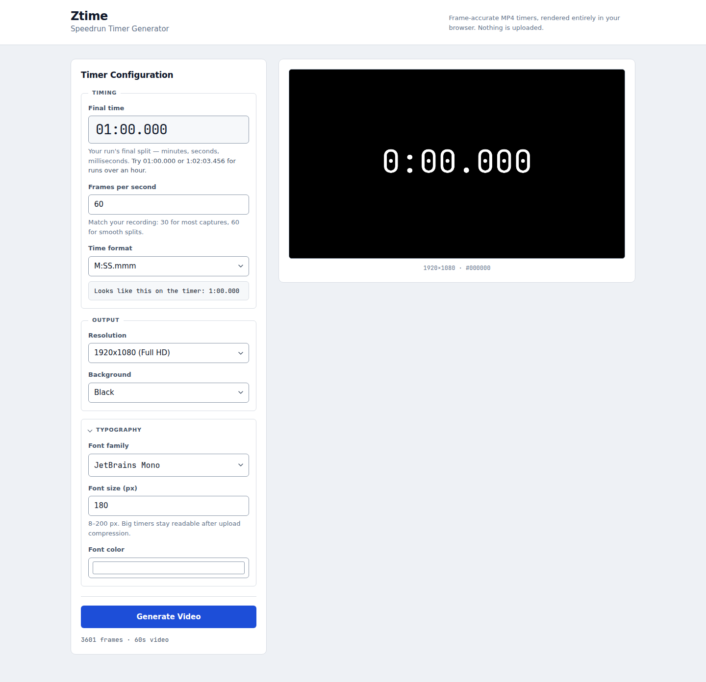
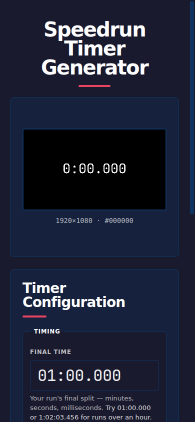

# Ztime — Speedrun Timer Generator

[](LICENSE)
[](#browser-support)

Generate pixel-accurate MP4 videos of a speedrun timer counting from 0 to your final split — frame-perfect, fully client-side, no upload.

**[Live demo →](https://zash60.github.io/Ztime/)**

## Screenshots

| Desktop | Mobile |
|---|---|
|  |  |

## Features

- **Frame-accurate timing** — every frame lands on the exact millisecond grid for your FPS
- **Configurable FPS** — 1–240, including fractional rates (23.976, 29.97, 59.94)
- **Multiple resolutions** — HD 720p, Full HD 1080p, 4K
- **11 timer formats** — from `M:SS.mmm` to `H:MM:SS` and centisecond/decisecond variants
- **26 vendored monospace fonts** — JetBrains Mono, Space Mono, Share Tech Mono, Ubuntu Mono, Cascadia Code, VT323, Roboto Mono, IBM Plex Mono, Source Code Pro, Fira Code, Inconsolata, PT Mono, Noto Sans Mono, DM Mono, Anonymous Pro, Cutive Mono, Cousine, Overpass Mono, Red Hat Mono, Azeret Mono, Martian Mono, Sometype Mono, Spline Sans Mono, B612 Mono, Kode Mono, Fragment Mono — no CDN, no system-font dependency
- **Hardware-accelerated encoding** — WebCodecs H.264 with realtime latency mode, running in a dedicated Web Worker (the UI stays responsive and the muxing never blocks the main thread)
- **Optional disk streaming** — with the File System Access API (Chrome/Edge) the MP4 is written straight to the file you pick as it encodes instead of being buffered in memory — a big win on long or 4K exports
- **Per-export timing breakdown** — paint / encode / finalize timings are logged to the console on every export
- **100% offline** — no server, no CDN, no upload; everything runs in your browser
- **Live preview** — see the timer before you generate
- **Cancel anytime** — stop generation mid-encode without losing your config

## Quick Start

```bash
git clone https://github.com/Zash60/Ztime.git
cd Ztime
node server.mjs
```

Open **http://127.0.0.1:8899/** in Chrome, Edge, or Safari.

Any static file server works — no build step, no dependencies.

## Configuration

| Option | Range | Default |
|---|---|---|
| Final time | `MM:SS.mmm` or `HH:MM:SS.mmm` | `01:00.000` |
| FPS | 1–240 | 60 |
| Resolution | 1280×720, 1920×1080, 3840×2160 | 1920×1080 |
| Background | Black, White, Red, Green, Blue | Black |
| Stream to disk | Off/on — pick a file, MP4 is streamed to it as it encodes (Chrome/Edge) | Off |
| Font family | 26 vendored monospace faces + system fallback | JetBrains Mono |
| Font size | 8–200 px | 180 |
| Font color | Any hex color | `#ffffff` |
| Time format | 11 formats (mmm, cc, d, s, hmmm, hcc, hd, hs, ssmmm, sscc, ssd) | `M:SS.mmm` |

## How It Works

1. **Frame plan** — the generator computes exact display times for every frame, starting at `00:00.000` and ending precisely on your final split
2. **Canvas rendering** — each frame is painted on a `<canvas>` with the selected font, color, and format
3. **Hardware encode** — frames are painted on the main thread (it owns the vendored fonts) as transferable `ImageBitmap`s and encoded in a **dedicated Web Worker** ([`js/encode-worker.js`](js/encode-worker.js)) via WebCodecs H.264 in realtime mode (no B-frames, no pipeline delay); when disk streaming is enabled the muxer writes straight into a `FileSystemWritableFileStream` instead of memory
4. **MP4 muxing** — [Mediabunny](https://github.com/Vanilagy/mediabunny) (vendored, MPL-2.0, see [`vendor/mediabunny/`](vendor/mediabunny/)) packages the encoded stream into a standards-compliant MP4
5. **Download** — the finished file saves directly to your device

## Project Structure

```
index.html          Entry point — markup only, no inline JS/CSS
css/                style.css (design system) + fonts.css (@font-face)
js/                 app.js · config.js · preview.js · timer.js · generator.js · encode-worker.js
fonts/              26 vendored .woff2 + licenses (see fonts/ATTRIBUTION.md)
vendor/mediabunny/  Vendored MP4 muxer (MPL-2.0)
server.mjs          Minimal static file server for local use
screenshots/        README assets
```

No build step, no transpiler, no framework — plain HTML/CSS/ES modules.

## Browser Support

| Browser | Minimum version | Notes |
|---|---|---|
| Chrome | 94+ | Full hardware encode |
| Edge | 94+ | Full hardware encode |
| Safari | 16.4+ | Full hardware encode |
| Firefox | — | Not supported (no WebCodecs H.264 encoder) |

Unsupported browsers fail at generation time with an explanatory message and a retry, keeping your settings — the encode is only attempted once you press Generate.

Disk streaming additionally requires the File System Access API (Chrome/Edge only); the toggle is hidden where the API is unavailable.

## Privacy

Everything runs locally: no uploads, no accounts, no analytics, no network calls after the page and its vendored assets load.

## Contributing

Issues and pull requests are welcome at [github.com/Zash60/Ztime](https://github.com/Zash60/Ztime). Keep the no-build-step philosophy: plain HTML/CSS/JS, vendored dependencies, no runtime CDN.

## License

Code: MIT (see [`LICENSE`](LICENSE)). Fonts: SIL Open Font License 1.1 / Ubuntu Font License 1.0 (see [`fonts/ATTRIBUTION.md`](fonts/ATTRIBUTION.md)). Mediabunny: MPL-2.0 (see [`vendor/mediabunny/LICENSE`](vendor/mediabunny/LICENSE)).
